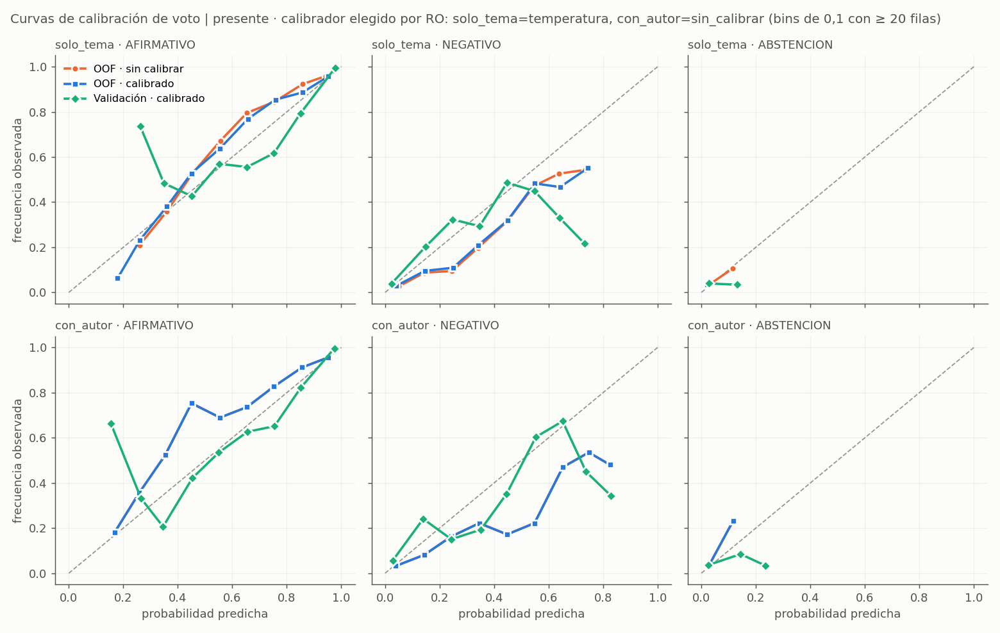

# Etapa 4 · Logística vs LightGBM, calibración, umbral e intervalos de conteo (validación 2023–2024)

Generado por `scripts/04_modelos.py` + `scripts/04b_tema_robustez.py` + `scripts/04_reporte.py`. **PRUEBA no se cargó ni se predijo.** Tests: `pytest tests` → 32 pasan (24 anteriores + 8 de la etapa 4: particiones del rolling origin, calibradores, umbral, intervalos y tema para la app).

> Todo lo que se ajusta sale de **predicciones out-of-fold (OOF) del rolling origin dentro de train**: familia, hiperparámetros, calibrador, pesos de decisión, σ/τ de los intervalos y residuos empíricos. Validación (25 votaciones, 6 sesiones) sólo se transforma y se reporta. OOF de voto: 115 votaciones de 2017, 2018, 2019 y 2022.

## Resumen

1. **Logística vs LightGBM, con los mismos folds:**
   - **Voto | presente:** gana la logística en las dos variantes (rolling origin 0,388 frente a 0,394 en solo_tema; 0,396 frente a 0,402 en con_autor). LightGBM sobreajusta en el fold 2022.
   - **Presencia:** gana LightGBM (0,400 frente a 0,406–0,409; mejor en 4–5 de 6 folds).
2. **solo_tema vs con_autor: la diferencia es chica y no es consistente.**
   - **Rolling origin:** con_autor es *peor* en voto (+0,008; gana sólo 2 de 4 folds).
   - **Validación:** el log loss empata (IC pareado del combinado [−0,055; +0,051]). con_autor mejora el F1 con umbral (+0,045) y el error en negativos Σp (−3,6), pero **predice RECHAZADAS 2 votaciones de Milei que fueron aprobadas** (acierto 0,92 contra 1,00).
   - **Recomendación:** hoy no vale el cambio en la app sólo por esto. Ver §3 y §8.
3. **Calibración:** las probabilidades ya estaban razonablemente calibradas (ECE ≤ 0,06).
   - Rolling origin elige temperatura (T = 0,90, apenas *más* concentrada) en solo_tema y nada en con_autor. La isotónica empeora en rolling origin.
   - El defecto que se ve en las curvas, NEGATIVO sobreconfiado por encima de 0,6, no lo arregla ningún calibrador monótono global.
4. **Umbral (pesos por clase sobre probabilidades calibradas, sin class weights):**
   - **F1 macro en validación:** sube de 0,391 a 0,450 (solo_tema) y de 0,462 a 0,496 (con_autor).
   - **ABSTENCION:** ahora aparece (33–34 aciertos de 200), con muchos falsos positivos.
5. **Intervalos de conteo:** suponer independencia da IC80 de ±8 votos que cubren el **6–24%** de las veces. Hay que modelar la correlación con un efecto común por votación (τ) y uno por bloque (σ).
   - **Simulación con σ y τ (elegidos en OOF):** cubre lo nominal en validación, 0,68–0,92 en IC80. A cambio, los IC80 miden alrededor de **±70 afirmativos** y **±50 negativos**, poco útiles para la app.
   - **Intervalos empíricos** (residuos OOF): son la mitad de anchos, pero en validación sólo cubren el 48–64%.
   - **Lectura:** el modelo todavía no sabe *cuáles* votaciones se van a dividir.

## 1. Logística vs LightGBM · rolling origin (mismos folds y mismas features)

| objetivo | variante | familia | hiperparámetro | log loss medio | F1 macro medio | por fold | folds mejor que la otra familia |
|---|---|---|---|---|---|---|---|
| presencia | con_autor | lgbm | h7_n150 | 0.4003 | 0.529 | 2017: 0.495 · 2018: 0.507 · 2019: 0.564 · 2020: 0.261 · 2021: 0.227 · 2022: 0.347 | 4/6 |
| presencia | con_autor | logistica | 0.001 | 0.4064 | 0.496 | 2017: 0.499 · 2018: 0.507 · 2019: 0.552 · 2020: 0.263 · 2021: 0.255 · 2022: 0.363 | 2/6 |
| presencia | solo_tema | lgbm | h7_n150 | 0.4005 | 0.525 | 2017: 0.499 · 2018: 0.506 · 2019: 0.557 · 2020: 0.264 · 2021: 0.226 · 2022: 0.350 | 5/6 |
| presencia | solo_tema | logistica | 0.001 | 0.4085 | 0.495 | 2017: 0.505 · 2018: 0.503 · 2019: 0.558 · 2020: 0.266 · 2021: 0.251 · 2022: 0.368 | 1/6 |
| voto | con_autor | lgbm | h4_n60 | 0.4023 | 0.392 | 2017: 0.409 · 2018: 0.464 · 2019: 0.253 · 2022: 0.483 | 1/4 |
| voto | con_autor | logistica | 0.003 | 0.3957 | 0.397 | 2017: 0.399 · 2018: 0.460 · 2019: 0.274 · 2022: 0.448 | 3/4 |
| voto | solo_tema | lgbm | h7_n60 | 0.3940 | 0.403 | 2017: 0.391 · 2018: 0.444 · 2019: 0.235 · 2022: 0.506 | 2/4 |
| voto | solo_tema | logistica | 0.003 | 0.3878 | 0.423 | 2017: 0.404 · 2018: 0.431 · 2019: 0.258 · 2022: 0.458 | 2/4 |

- **Variantes de features:**
  - **solo_tema:** voto = tema + hist_tema; presencia = tema.
  - **con_autor:** voto = origen, signo_autor, alineación, inter_signo, inter_bloque, tema, hist_tema; presencia = origen, alineación, inter_signo, tema.
  - Las dos llevan la base de la etapa 2: historial, distrito, bloque y signo al inicio. Se sacó es_autor.
- **Grillas:**
  - **Logística:** C ∈ {0,0003 … 0,03}.
  - **LightGBM:** hojas ∈ {4, 7, 15}, árboles ∈ {60, 100, 150, 300}, learning rate 0,05, min_child_samples 200, sin class weights. Agregué configuraciones más regularizadas después de ver que LightGBM sobreajustaba con 200–500 árboles en un fold: la grilla se decidió con rolling origin, no con validación.
- **Elección por rolling origin:**
  - **Voto:** logística C=0,003 en las dos variantes.
  - **Presencia:** LightGBM (7 hojas, 150 árboles) en las dos.

## 2. Tabla comparativa principal · validación · historial móvil · IC95 por sesión

| modelo | B · log loss | B · Brier | B · F1 argmax | B · F1 con umbral | B · ECE A/N/Abs | A · log loss | A×B · log loss | A×B · F1 | Vot · EA afirm. Σp | Vot · EA neg. Σp | Spearman neg. Σp | acierto resultado (Σp) | cobertura IC80 / IC90 (afirm · neg) |
|---|---|---|---|---|---|---|---|---|---|---|---|---|---|
| Ref. etapa 2 (logística bloque/signo + historial) | 0.505 [0.408, 0.597] | 0.304 [0.233, 0.375] | 0.322 [0.290, 0.352] | 0.322 | 0.080 / 0.052 / 0.002 | 0.373 [0.302, 0.481] | 0.844 [0.786, 0.884] | 0.243 [0.223, 0.257] | 35.2 [26.1, 45.9] | 41.1 [35.7, 47.4] | 0.01 [-0.37, 0.58] | 1.00 [1.00, 1.00] | — |
| Etapa 3 · todas las features (logística) | 0.494 [0.356, 0.630] | 0.282 [0.190, 0.376] | 0.419 [0.363, 0.487] | 0.419 | 0.040 / 0.040 / 0.010 | 0.372 [0.292, 0.474] | 0.837 [0.771, 0.908] | 0.314 [0.277, 0.348] | 32.8 [25.5, 41.8] | 32.6 [23.9, 44.0] | 0.45 [0.22, 0.85] | 1.00 [1.00, 1.00] | — |
| solo_tema · sin calibrar | 0.499 [0.362, 0.619] | 0.295 [0.205, 0.381] | 0.391 [0.352, 0.454] | 0.391 | 0.049 / 0.047 / 0.006 | 0.374 [0.310, 0.464] | 0.831 [0.744, 0.905] | 0.326 [0.280, 0.373] | 37.4 [26.5, 51.6] | 35.4 [26.9, 43.7] | 0.42 [0.28, 0.76] | 1.00 [1.00, 1.00] | — |
| **solo_tema** · calibrado + umbral | 0.502 [0.355, 0.635] | 0.299 [0.205, 0.391] | 0.391 [0.352, 0.454] | 0.450 | 0.062 / 0.051 / 0.016 | 0.374 [0.310, 0.464] | 0.834 [0.735, 0.916] | 0.325 [0.279, 0.372] | 37.2 [26.9, 49.7] | 34.8 [25.6, 43.7] | 0.43 [0.28, 0.75] | 1.00 [1.00, 1.00] | 0.76/0.76 · 0.92/1.00 |
| con_autor · sin calibrar | 0.501 [0.347, 0.677] | 0.276 [0.183, 0.373] | 0.462 [0.401, 0.523] | 0.462 | 0.048 / 0.064 / 0.017 | 0.371 [0.294, 0.470] | 0.835 [0.745, 0.943] | 0.368 [0.330, 0.407] | 34.4 [26.6, 44.3] | 31.2 [21.0, 43.5] | 0.40 [0.05, 0.84] | 0.92 [0.75, 1.00] | — |
| **con_autor** · calibrado + umbral | 0.501 [0.347, 0.677] | 0.276 [0.183, 0.373] | 0.462 [0.401, 0.523] | 0.496 | 0.048 / 0.064 / 0.017 | 0.371 [0.294, 0.470] | 0.835 [0.745, 0.943] | 0.368 [0.330, 0.407] | 34.4 [26.6, 44.3] | 31.2 [21.0, 43.5] | 0.40 [0.05, 0.84] | 0.92 [0.75, 1.00] | 0.68/0.88 · 0.68/0.84 |

- **Columnas:**
  - **B** = voto | presente.
  - **A** = presencia.
  - **A×B** = combinado de 4 clases.
  - **F1 con umbral:** regla argmax(w·p) con los pesos elegidos en OOF (§5).
  - **ECE:** uno contra el resto, 10 bins.
  - **Acierto de resultado:** con conteo esperado Σp.
  - **Cobertura:** intervalo simulado con efecto por bloque y por votación, contra totales oficiales.
- **Calibrado vs sin calibrar:** en con_autor coinciden porque rolling origin eligió no calibrar.

Historial congelado al 2023-01-01:

| modelo | B · log loss | B · Brier | B · F1 argmax | B · F1 con umbral | B · ECE A/N/Abs | A · log loss | A×B · log loss | A×B · F1 | Vot · EA afirm. Σp | Vot · EA neg. Σp | Spearman neg. Σp | acierto resultado (Σp) | cobertura IC80 / IC90 (afirm · neg) |
|---|---|---|---|---|---|---|---|---|---|---|---|---|---|
| Ref. etapa 2 (logística bloque/signo + historial) | 0.498 [0.406, 0.583] | 0.299 [0.232, 0.364] | 0.305 [0.285, 0.329] | — | — | 0.384 [0.313, 0.486] | 0.845 [0.786, 0.884] | 0.223 [0.217, 0.234] | 34.4 [25.9, 43.8] | 41.1 [35.6, 47.3] | -0.11 [-0.48, 0.40] | 1.00 [1.00, 1.00] | — |
| Etapa 3 · todas las features (logística) | 0.489 [0.354, 0.618] | 0.278 [0.189, 0.370] | 0.406 [0.354, 0.481] | — | — | 0.398 [0.320, 0.496] | 0.848 [0.774, 0.915] | 0.304 [0.261, 0.347] | 33.3 [25.4, 43.2] | 32.9 [24.4, 44.1] | 0.49 [0.23, 0.85] | 1.00 [1.00, 1.00] | — |
| solo_tema · sin calibrar | 0.492 [0.359, 0.607] | 0.291 [0.201, 0.372] | 0.390 [0.342, 0.459] | — | — | 0.389 [0.320, 0.476] | 0.836 [0.736, 0.918] | 0.323 [0.268, 0.378] | 38.1 [26.1, 54.0] | 35.6 [27.2, 43.8] | 0.47 [0.32, 0.77] | 1.00 [1.00, 1.00] | — |
| **solo_tema** · calibrado + umbral | 0.495 [0.351, 0.623] | 0.294 [0.200, 0.380] | 0.390 [0.342, 0.459] | — | — | 0.389 [0.320, 0.476] | 0.839 [0.741, 0.921] | 0.317 [0.261, 0.373] | 37.8 [26.9, 52.2] | 35.0 [25.9, 43.9] | 0.45 [0.30, 0.78] | 1.00 [1.00, 1.00] | 0.76/0.76 · 0.92/1.00 |
| con_autor · sin calibrar | 0.498 [0.348, 0.660] | 0.274 [0.182, 0.366] | 0.459 [0.397, 0.525] | — | — | 0.386 [0.305, 0.483] | 0.841 [0.750, 0.931] | 0.365 [0.326, 0.410] | 35.5 [26.2, 47.5] | 30.8 [20.5, 43.3] | 0.43 [0.07, 0.85] | 0.92 [0.75, 1.00] | — |
| **con_autor** · calibrado + umbral | 0.498 [0.348, 0.660] | 0.274 [0.182, 0.366] | 0.459 [0.397, 0.525] | — | — | 0.386 [0.305, 0.483] | 0.841 [0.750, 0.931] | 0.365 [0.326, 0.410] | 35.5 [26.2, 47.5] | 30.8 [20.5, 43.3] | 0.43 [0.07, 0.85] | 0.92 [0.75, 1.00] | 0.68/0.88 · 0.68/0.84 |

## 3. ¿Vale identificar al autor en la app? con_autor − solo_tema

| métrica | diferencia | detalle |
|---|---|---|
| RO · log loss voto (con_autor − solo_tema) | +0.0079 | 2017: -0.005 · 2018: +0.030 · 2019: +0.016 · 2022: -0.009 · con_autor gana 2/4 |
| RO · log loss presencia (con_autor − solo_tema) | -0.0002 | 2017: -0.004 · 2018: +0.001 · 2019: +0.007 · 2020: -0.003 · 2021: +0.001 · 2022: -0.003 · con_autor gana 3/6 |
| Val · log loss A×B 4 clases (con_autor − solo_tema) | +0.0004 | IC95 bootstrap pareado por sesión [-0.0553; +0.0508] |
| Val · EA neg. Σp | -3.6 | con_autor 31.2 · solo_tema 34.8 |
| Val · EA afirm. Σp | -2.8 | con_autor 34.4 · solo_tema 37.2 |
| Val · Spearman neg. | -0.03 | con_autor 0.40 · solo_tema 0.43 |
| Val · acierto resultado | -0.08 | con_autor 0.92 · solo_tema 1.00 |
| Val · F1 B con umbral | +0.045 | con_autor 0.496 · solo_tema 0.450 |
| Val · log loss B | -0.001 | con_autor 0.501 · solo_tema 0.502 |

**Lectura:**
- **Rolling origin:** la información del autor no mejora el log loss.
- **Validación:** ayuda en el F1 con umbral y en el error de conteo de negativos, pero empeora el resultado en los proyectos del Ejecutivo de Milei (§7).
- **Origen del problema:** la feature de alineación interactúa con un `signo` documental que clasifica a PRO y UCR como NO_OFICIALISTA bajo Milei, cuando en 2024 votaron con el gobierno.
- **Recomendación:**
  - **No pedir todavía** el cambio estructural del autor en la app.
  - **Primero**, agregar una feature de "alineación reciente del bloque con el oficialismo" (proporción de votaciones de los últimos meses, antes de D-1, en las que el bloque votó como el bloque oficialista) y repetir esta comparación.
  - Si con eso con_autor gana en rolling origin, se pide el cambio en la app.

## 4. Calibración (elegida con rolling sobre los folds OOF: el calibrador se ajusta con los folds anteriores y se evalúa en el siguiente)

| variante | objetivo | elegido (RO) | log loss RO · sin calibrar / temperatura / isotónica | T | ECE OOF A/N/Abs antes → después |
|---|---|---|---|---|---|
| solo_tema | voto | temperatura | 0.3822 / 0.3792 / 0.4088 | 0.896 | 0.053 / 0.057 / 0.006 → 0.031 / 0.044 / 0.013 |
| solo_tema | presencia | sin_calibrar | 0.3807 / 0.3843 / 0.3927 | — | — |
| con_autor | voto | sin_calibrar | 0.3944 / 0.3977 / 0.4050 | — | 0.044 / 0.051 / 0.007 → 0.044 / 0.051 / 0.007 |
| con_autor | presencia | sin_calibrar | 0.3814 / 0.3841 / 0.3882 | — | — |

- **Cómo leer el gráfico:**
  - La diagonal es la calibración perfecta.
  - En con_autor el calibrador elegido es "sin calibrar", así que las curvas OOF con y sin calibrar coinciden.
  - ABSTENCION casi nunca supera 0,2, así que sólo hay 1 o 2 bins con datos.
- **Lo que muestran:**
  - AFIRMATIVO está bien calibrado.
  - **NEGATIVO** sigue la diagonal hasta alrededor de 0,5 y después queda **sobreconfiado**: con p ≈ 0,7–0,8, el NEGATIVO real es 0,2–0,55. En validación esa zona son justamente PRO y UCR en proyectos de Milei.
  - Una temperatura única no puede corregir esa forma, y la isotónica sobreajusta, porque hay pocas filas en la cola.

## 5. Umbral de decisión (pesos por clase elegidos en OOF calibrado)

| variante | pesos (AFIRM, NEG, ABST) | F1 OOF argmax → con umbral | F1 validación argmax → con umbral |
|---|---|---|---|
| solo_tema | 1, 1.25, 8 | 0.429 → 0.464 | 0.391 → 0.450 |
| con_autor | 1, 2.25, 8 | 0.414 → 0.465 | 0.462 → 0.496 |

**solo_tema · con umbral (validación)**

| real | pred AFIRM | pred NEG | pred ABST |
|---|---|---|---|
| AFIRM | 3512 | 327 | 149 |
| NEG | 421 | 281 | 192 |
| ABST | 113 | 54 | 33 |

**con_autor · con umbral (validación)**

| real | pred AFIRM | pred NEG | pred ABST |
|---|---|---|---|
| AFIRM | 3332 | 459 | 197 |
| NEG | 190 | 491 | 213 |
| ABST | 40 | 126 | 34 |

- **Uso:** este umbral sirve para mostrar un voto por diputado en la app.
- **Por qué no se usa para contar:** el conteo por votación se hace con Σp (§6), que no depende del umbral y tiene menos error que contar votos por argmax o por umbral.
- **ABSTENCION:** casi no se puede predecir (F1 de la clase ≈ 0,1). Propongo mostrarla en la app sólo como probabilidad, no como voto.

## 6. Conteo esperado e intervalos sin asumir independencia

- **Modelo de simulación:**
  - Cada diputado vota según sus probabilidades calibradas, más dos efectos aleatorios en el logit de NEGATIVO, ABSTENCION y AUSENTE (relativos a AFIRMATIVO).
  - Un efecto es común a toda la votación (τ): toda la Cámara se corre hacia el consenso o hacia la división.
  - El otro es común a cada bloque en esa votación (σ): el bloque se mueve junto.
  - (σ, τ) se eligen en OOF, buscando la cobertura más cercana a 80% y 90%.
- **Alternativa empírica:** Σp + cuantiles de los residuos OOF.
- **Referencias de cobertura:**
  - **Filas existentes:** lo que el modelo puede ver.
  - **Totales oficiales:** incluyen las 7–14 bancas sin fila por votación, que cuentan como "sin asignar".

Selección de (σ, τ) en OOF (las mejores 4 y el caso independiente):

| variante | σ bloque | τ votación | elegido | cob. IC80 afirm/neg | cob. IC90 afirm/neg | ancho IC80 afirm/neg |
|---|---|---|---|---|---|---|
| solo_tema | 2 | 3 | ✔ | 0.80 / 0.87 | 0.98 / 1.00 | 160 / 131 |
| solo_tema | 0.5 | 2 |  | 0.96 / 0.78 | 0.99 / 0.95 | 145 / 96 |
| solo_tema | 1.5 | 2 |  | 0.82 / 0.61 | 0.97 / 0.85 | 133 / 98 |
| solo_tema | 1 | 2 |  | 0.91 / 0.70 | 0.98 / 0.93 | 140 / 97 |
| solo_tema | 0 | 0 | (independencia) | 0.18 / 0.06 | 0.23 / 0.08 | 16 / 10 |
| con_autor | 1 | 2 | ✔ | 0.83 / 0.76 | 0.96 / 0.90 | 140 / 93 |
| con_autor | 0.5 | 2 |  | 0.90 / 0.77 | 0.98 / 0.92 | 145 / 92 |
| con_autor | 0 | 2 |  | 0.91 / 0.79 | 0.99 / 0.94 | 147 / 93 |
| con_autor | 2 | 3 |  | 0.76 / 0.88 | 0.96 / 1.00 | 158 / 127 |
| con_autor | 0 | 0 | (independencia) | 0.24 / 0.07 | 0.29 / 0.07 | 17 / 10 |

Cobertura real, todas las votaciones:

| conjunto | metodo | referencia | votaciones | IC80 afirm / neg | IC90 afirm / neg | ancho IC80 afirm / neg |
|---|---|---|---|---|---|---|
| OOF (solo_tema) | independiente (σ=0) | filas existentes | 115 | 0.18 / 0.07 | 0.24 / 0.09 | 17 / 10 |
| OOF (solo_tema) | independiente (σ=0) | totales oficiales | 115 | 0.18 / 0.05 | 0.22 / 0.10 | 17 / 10 |
| OOF (solo_tema) | efecto bloque + votación (σ=2, τ=3) | filas existentes | 115 | 0.79 / 0.90 | 0.98 / 1.00 | 160 / 132 |
| OOF (solo_tema) | efecto bloque + votación (σ=2, τ=3) | totales oficiales | 115 | 0.54 / 0.89 | 0.78 / 1.00 | 160 / 132 |
| OOF (solo_tema) | empírico (residuos OOF) | filas existentes | 115 | 0.79 / 0.79 | 0.90 / 0.90 | 75 / 46 |
| OOF (solo_tema) | empírico (residuos OOF) | totales oficiales | 115 | 0.62 / 0.76 | 0.69 / 0.87 | 75 / 46 |
| OOF (con_autor) | independiente (σ=0) | filas existentes | 115 | 0.24 / 0.07 | 0.29 / 0.07 | 17 / 10 |
| OOF (con_autor) | independiente (σ=0) | totales oficiales | 115 | 0.14 / 0.06 | 0.17 / 0.09 | 17 / 10 |
| OOF (con_autor) | efecto bloque + votación (σ=1, τ=2) | filas existentes | 115 | 0.85 / 0.75 | 0.95 / 0.91 | 140 / 94 |
| OOF (con_autor) | efecto bloque + votación (σ=1, τ=2) | totales oficiales | 115 | 0.58 / 0.75 | 0.75 / 0.90 | 140 / 94 |
| OOF (con_autor) | empírico (residuos OOF) | filas existentes | 115 | 0.79 / 0.79 | 0.90 / 0.90 | 82 / 44 |
| OOF (con_autor) | empírico (residuos OOF) | totales oficiales | 115 | 0.65 / 0.76 | 0.75 / 0.87 | 82 / 44 |
| VALIDACION (solo_tema) | independiente (σ=0) | filas existentes | 25 | 0.12 / 0.00 | 0.16 / 0.00 | 16 / 12 |
| VALIDACION (solo_tema) | independiente (σ=0) | totales oficiales | 25 | 0.20 / 0.00 | 0.20 / 0.00 | 16 / 12 |
| VALIDACION (solo_tema) | efecto bloque + votación (σ=2, τ=3) | filas existentes | 25 | 0.76 / 0.92 | 0.84 / 1.00 | 169 / 136 |
| VALIDACION (solo_tema) | efecto bloque + votación (σ=2, τ=3) | totales oficiales | 25 | 0.76 / 0.92 | 0.76 / 1.00 | 169 / 136 |
| VALIDACION (solo_tema) | empírico (residuos OOF) | filas existentes | 25 | 0.48 / 0.56 | 0.60 / 0.68 | 75 / 49 |
| VALIDACION (solo_tema) | empírico (residuos OOF) | totales oficiales | 25 | 0.44 / 0.56 | 0.60 / 0.68 | 75 / 49 |
| VALIDACION (con_autor) | independiente (σ=0) | filas existentes | 25 | 0.16 / 0.08 | 0.20 / 0.08 | 16 / 12 |
| VALIDACION (con_autor) | independiente (σ=0) | totales oficiales | 25 | 0.16 / 0.08 | 0.20 / 0.08 | 16 / 12 |
| VALIDACION (con_autor) | efecto bloque + votación (σ=1, τ=2) | filas existentes | 25 | 0.72 / 0.68 | 0.96 / 0.88 | 136 / 102 |
| VALIDACION (con_autor) | efecto bloque + votación (σ=1, τ=2) | totales oficiales | 25 | 0.68 / 0.68 | 0.88 / 0.84 | 136 / 102 |
| VALIDACION (con_autor) | empírico (residuos OOF) | filas existentes | 25 | 0.52 / 0.64 | 0.76 / 0.76 | 82 / 47 |
| VALIDACION (con_autor) | empírico (residuos OOF) | totales oficiales | 25 | 0.56 / 0.64 | 0.76 / 0.76 | 82 / 47 |

**Lectura:**
- **Independencia:** subestima muchísimo la incertidumbre. El IC80 cubre 0–24%.
- **Por qué los intervalos simulados son tan anchos:** la distribución real es **bimodal**. En 2 de cada 3 votaciones hay 0–5 negativos; en las demás, 80–110. Σp, en cambio, predice un valor intermedio (mediana 16).
- **Cobertura en OOF:** es optimista, porque σ y τ se eligieron con esos mismos datos.
- **Cobertura en validación:** es la medición honesta. Los intervalos simulados cubren el nivel nominal, pero miden ±60–80 votos.
- **Intervalos empíricos:** quedan cortos en validación (0,48–0,64). 2023–2024 tuvo más votaciones divididas que el promedio de train.
- **Propuesta para la app:** mostrar Σp con el intervalo simulado y, al lado, una alerta de "votación potencialmente dividida" cuando el IC80 de negativos supere un umbral. Un intervalo estrecho sería falsa precisión.

## 7. Estrato de votaciones divididas (margen oficial < 100)

| conjunto | modelo | votaciones divididas (<100) | EA afirm. Σp | EA neg. Σp | EA neg. argmax | consensuadas · EA neg. Σp |
|---|---|---|---|---|---|---|
| OOF | **solo_tema** · calibrado + umbral | 21 | 25.1 [16.2, 37.0] | 42.1 [31.2, 55.6] | 55.3 [45.6, 68.1] | 17.1 [14.7, 20.4] |
| OOF | **con_autor** · calibrado + umbral | 21 | 23.6 [16.7, 33.9] | 41.4 [29.8, 54.7] | 50.8 [36.7, 64.5] | 18.8 [15.8, 22.7] |
| VALIDACION | Ref. etapa 2 (logística bloque/signo + historial) | 10 | 28.2 [15.0, 40.3] | 48.9 [31.8, 66.6] | 80.1 [63.3, 98.6] | 36.0 [29.7, 48.1] |
| VALIDACION | Etapa 3 · todas las features (logística) | 10 | 33.9 [28.0, 39.2] | 45.7 [22.4, 66.4] | 52.4 [24.3, 67.7] | 23.8 [20.5, 27.3] |
| VALIDACION | solo_tema · sin calibrar | 10 | 37.3 [30.9, 45.1] | 48.6 [28.2, 66.8] | 57.5 [30.6, 73.8] | 26.6 [16.9, 41.6] |
| VALIDACION | **solo_tema** · calibrado + umbral | 10 | 38.2 [28.7, 47.2] | 49.9 [28.6, 68.5] | 57.1 [29.7, 73.0] | 24.7 [14.8, 39.8] |
| VALIDACION | con_autor · sin calibrar | 10 | 40.0 [35.1, 47.1] | 46.0 [20.4, 67.5] | 59.6 [34.6, 79.0] | 21.3 [17.6, 24.3] |
| VALIDACION | **con_autor** · calibrado + umbral | 10 | 40.0 [35.1, 47.1] | 46.0 [20.4, 67.5] | 59.6 [34.6, 79.0] | 21.3 [17.6, 24.3] |

Cobertura en divididas:

| conjunto | metodo | referencia | votaciones | IC80 afirm / neg | IC90 afirm / neg | ancho IC80 afirm / neg |
|---|---|---|---|---|---|---|
| OOF (solo_tema) | independiente (σ=0) | filas existentes | 21 | 0.05 / 0.14 | 0.10 / 0.14 | 16 / 11 |
| OOF (solo_tema) | independiente (σ=0) | totales oficiales | 21 | 0.29 / 0.10 | 0.33 / 0.10 | 16 / 11 |
| OOF (solo_tema) | efecto bloque + votación (σ=2, τ=3) | filas existentes | 21 | 1.00 / 1.00 | 1.00 / 1.00 | 157 / 139 |
| OOF (solo_tema) | efecto bloque + votación (σ=2, τ=3) | totales oficiales | 21 | 1.00 / 0.90 | 1.00 / 1.00 | 157 / 139 |
| OOF (solo_tema) | empírico (residuos OOF) | filas existentes | 21 | 0.62 / 0.43 | 0.71 / 0.71 | 75 / 49 |
| OOF (solo_tema) | empírico (residuos OOF) | totales oficiales | 21 | 0.86 / 0.24 | 0.86 / 0.57 | 75 / 49 |
| OOF (con_autor) | independiente (σ=0) | filas existentes | 21 | 0.19 / 0.10 | 0.24 / 0.10 | 17 / 12 |
| OOF (con_autor) | independiente (σ=0) | totales oficiales | 21 | 0.19 / 0.10 | 0.29 / 0.14 | 17 / 12 |
| OOF (con_autor) | efecto bloque + votación (σ=1, τ=2) | filas existentes | 21 | 1.00 / 0.90 | 1.00 / 0.95 | 135 / 107 |
| OOF (con_autor) | efecto bloque + votación (σ=1, τ=2) | totales oficiales | 21 | 1.00 / 0.86 | 1.00 / 0.90 | 135 / 107 |
| OOF (con_autor) | empírico (residuos OOF) | filas existentes | 21 | 0.67 / 0.43 | 0.81 / 0.71 | 82 / 48 |
| OOF (con_autor) | empírico (residuos OOF) | totales oficiales | 21 | 0.90 / 0.29 | 0.90 / 0.57 | 82 / 48 |
| VALIDACION (solo_tema) | independiente (σ=0) | filas existentes | 10 | 0.10 / 0.00 | 0.10 / 0.00 | 17 / 13 |
| VALIDACION (solo_tema) | independiente (σ=0) | totales oficiales | 10 | 0.10 / 0.00 | 0.10 / 0.00 | 17 / 13 |
| VALIDACION (solo_tema) | efecto bloque + votación (σ=2, τ=3) | filas existentes | 10 | 1.00 / 1.00 | 1.00 / 1.00 | 164 / 146 |
| VALIDACION (solo_tema) | efecto bloque + votación (σ=2, τ=3) | totales oficiales | 10 | 1.00 / 1.00 | 1.00 / 1.00 | 164 / 146 |
| VALIDACION (solo_tema) | empírico (residuos OOF) | filas existentes | 10 | 0.30 / 0.30 | 0.60 / 0.40 | 75 / 51 |
| VALIDACION (solo_tema) | empírico (residuos OOF) | totales oficiales | 10 | 0.30 / 0.30 | 0.50 / 0.30 | 75 / 51 |
| VALIDACION (con_autor) | independiente (σ=0) | filas existentes | 10 | 0.10 / 0.20 | 0.10 / 0.20 | 16 / 13 |
| VALIDACION (con_autor) | independiente (σ=0) | totales oficiales | 10 | 0.10 / 0.20 | 0.10 / 0.20 | 16 / 13 |
| VALIDACION (con_autor) | efecto bloque + votación (σ=1, τ=2) | filas existentes | 10 | 0.80 / 0.60 | 1.00 / 0.80 | 132 / 118 |
| VALIDACION (con_autor) | efecto bloque + votación (σ=1, τ=2) | totales oficiales | 10 | 0.80 / 0.60 | 1.00 / 0.70 | 132 / 118 |
| VALIDACION (con_autor) | empírico (residuos OOF) | filas existentes | 10 | 0.30 / 0.30 | 0.60 / 0.60 | 82 / 51 |
| VALIDACION (con_autor) | empírico (residuos OOF) | totales oficiales | 10 | 0.40 / 0.30 | 0.70 / 0.60 | 82 / 51 |

- **Error en negativos Σp:** en las divididas sigue en 42–50 por votación con todos los modelos, contra 17–25 en las consensuadas.
- **Intervalos:** los simulados cubren las divididas porque son anchos. Los empíricos no las cubren.

### Diagnóstico: votaciones de validación que se predicen RECHAZADAS (no se usa para elegir)

| modelo | votacion_id | pred_res | esp_res | pred_AFIRMATIVO | pred_NEGATIVO | esp_AFIRMATIVO | esp_NEGATIVO | of_A | of_N |
|---|---|---|---|---|---|---|---|---|---|
| etapa3_d_todas | HCDN_ACTA_5385 | RECHAZADO | APROBADO | 90 | 148 | 94.7 | 92.4 | 142 | 89 |
| con_autor__sin_calibrar | HCDN_ACTA_5101 | RECHAZADO | RECHAZADO | 70 | 172 | 89.8 | 104.4 | 144 | 109 |
| con_autor__sin_calibrar | HCDN_ACTA_5385 | RECHAZADO | RECHAZADO | 60 | 172 | 80.9 | 111.8 | 142 | 89 |
| con_autor | HCDN_ACTA_5101 | RECHAZADO | RECHAZADO | 70 | 172 | 89.8 | 104.4 | 144 | 109 |
| con_autor | HCDN_ACTA_5385 | RECHAZADO | RECHAZADO | 60 | 172 | 80.9 | 111.8 | 142 | 89 |

Desglose por bloque de **HCDN_ACTA_5385** (etapa 3, todas las features):

| bloque_inicio | signo_inicio | diputados | pred_afirm | pred_neg | esp_neg | real_afirm | real_neg |
|---|---|---|---|---|---|---|---|
| UNION POR LA PATRIA | NO_OFICIALISTA | 97 | 20 | 72 | 40.4 | 1 | 83 |
| PRO | NO_OFICIALISTA | 37 | 2 | 31 | 16.1 | 33 | 0 |
| LA LIBERTAD AVANZA | OFICIALISMO | 37 | 37 | 0 | 5.0 | 37 | 0 |
| UCR - UNION CIVICA RADICAL | NO_OFICIALISTA | 32 | 0 | 31 | 15.4 | 31 | 0 |
| ENCUENTRO FEDERAL | NO_VERIFICADO | 16 | 10 | 4 | 4.7 | 13 | 0 |
| INNOVACION FEDERAL | NO_VERIFICADO | 8 | 8 | 0 | 2.1 | 7 | 0 |
| COALICION CIVICA | NO_OFICIALISTA | 6 | 0 | 6 | 3.1 | 6 | 0 |
| MID - MOVIMIENTO DE INTEGRACION Y DESARROLLO | NO_VERIFICADO | 3 | 3 | 0 | 1.0 | 3 | 0 |

- **Etapa 3 (todas las features, argmax):** predijo RECHAZADA **HCDN_ACTA_5385**, el proyecto del Ejecutivo de Milei sobre regularización de armas de fuego (0007-PE-2024, tema JUSTICIA_SEGURIDAD). Fue aprobado 142 a 89.
- **con_autor en la etapa 4:** también predice RECHAZADA **HCDN_ACTA_5101**, la Ley Bases (144 a 109), incluso con Σp.
- **Causa:** el error viene de **PRO (37 diputados) y UCR (32)**.
  - La regla documental del dataset los clasifica **NO_OFICIALISTA** bajo Milei. El propio dataset advierte que "bloque nuclear distinto no implica oposición a todo proyecto".
  - En train, la combinación "proyecto del Ejecutivo vigente × diputado no oficialista" casi siempre votó en contra: con CFK y con Macri, la oposición principal se oponía a los proyectos del Ejecutivo.
  - En 2024, PRO y UCR votaron a favor (33 de 37 y 31 de 32), pero el modelo les asigna P(NEG) ≈ 0,45–0,55 y, con argmax, NEGATIVO.
- **Por qué es un cambio de régimen:** un gobierno con un bloque propio de 37 diputados, que gobierna con apoyo de la oposición "dialoguista". No hay ejemplos de eso en train.
- **Por qué solo_tema lo esquiva:** no usa la alineación del autor. Su predicción para esos bloques depende más del historial personal y del tema.
- **Remedio propuesto:** la feature de alineación reciente del bloque con el oficialismo (§3), calculada con votos anteriores a D-1, que ya existen en 2024 desde diciembre de 2023.

## 8. Con y sin historial

| historial | modelo | subgrupo | n | log loss | F1 macro |
|---|---|---|---|---|---|
| movil | Ref. etapa 2 (logística bloque/signo + historial) | con_historial | 5048.0 | 0.502 [0.408, 0.591] | 0.323 [0.292, 0.352] |
| movil | Ref. etapa 2 (logística bloque/signo + historial) | sin_historial | 34.0 | 1.013 [0.334, 1.265] | 0.222 [0.167, 1.000] |
| movil | **solo_tema** · calibrado + umbral | con_historial | 5048.0 | 0.497 [0.355, 0.625] | 0.392 [0.353, 0.456] |
| movil | **solo_tema** · calibrado + umbral | sin_historial | 34.0 | 1.322 [0.298, 1.703] | 0.222 [0.167, 1.000] |
| movil | **con_autor** · calibrado + umbral | con_historial | 5048.0 | 0.496 [0.347, 0.668] | 0.464 [0.403, 0.524] |
| movil | **con_autor** · calibrado + umbral | sin_historial | 34.0 | 1.352 [0.318, 1.743] | 0.213 [0.167, 0.455] |
| congelado | Ref. etapa 2 (logística bloque/signo + historial) | con_historial | 4402.0 | 0.511 [0.405, 0.633] | 0.304 [0.280, 0.332] |
| congelado | Ref. etapa 2 (logística bloque/signo + historial) | sin_historial | 680.0 | 0.413 [0.372, 0.842] | 0.303 [0.244, 0.433] |
| congelado | **solo_tema** · calibrado + umbral | con_historial | 4402.0 | 0.511 [0.352, 0.662] | 0.380 [0.312, 0.455] |
| congelado | **solo_tema** · calibrado + umbral | sin_historial | 680.0 | 0.392 [0.334, 1.083] | 0.460 [0.244, 0.801] |
| congelado | **con_autor** · calibrado + umbral | con_historial | 4402.0 | 0.516 [0.351, 0.689] | 0.451 [0.393, 0.523] |
| congelado | **con_autor** · calibrado + umbral | sin_historial | 680.0 | 0.383 [0.316, 1.108] | 0.510 [0.271, 0.775] |

## 9. Ejecutivo de un gobierno anterior · filas de train (punto 5)

- **Tamaño:** **923 filas** de voto | presente en **5 votaciones** de train. Detalle: 4 votación(es) de un proyecto de CFK_2011 votado con MACRI_2015; 1 votación(es) de un proyecto de MACRI_2015 votado con AF_2019.
- **Votos:** el 97.2% fue AFIRMATIVO; son proyectos de consenso que quedaron pendientes de un gobierno al siguiente.
- **Consecuencia:** el modelo casi no tiene ejemplos de un proyecto del Ejecutivo anterior con votación dividida. En validación hay 677 filas así (proyectos de AF votados con Milei), y con 5 votaciones de train esa categoría no se puede estimar bien.

## 10. Robustez del tema (punto 6)

Sobre las 425 votaciones generales de train y validación. Formato: "% OTROS · % igual al tema del título original".

| entrada | regla | train: % OTROS · % igual | validación: % OTROS · % igual |
|---|---|---|---|
| original | propuesta app (limpia prefijos) | 6% · 100% | 8% · 100% |
| original | reglas actuales | 6% · 100% | 8% · 100% |
| minúsculas | propuesta app (limpia prefijos) | 6% · 100% | 8% · 100% |
| minúsculas | reglas actuales | 6% · 100% | 8% · 100% |
| con prefijo 'Proyecto de ley: ' | propuesta app (limpia prefijos) | 6% · 100% | 8% · 100% |
| con prefijo 'Proyecto de ley: ' | reglas actuales | 8% · 94% | 12% · 92% |
| con prefijo 'PROYECTO DE LEY - ' (mayúsc.) | propuesta app (limpia prefijos) | 6% · 100% | 8% · 100% |
| con prefijo 'PROYECTO DE LEY - ' (mayúsc.) | reglas actuales | 8% · 94% | 12% · 92% |
| sin puntuación | propuesta app (limpia prefijos) | 6% · 100% | 8% · 100% |
| sin puntuación | reglas actuales | 6% · 100% | 8% · 100% |
| abreviado (L., art., nac., modif., rég.) | propuesta app (limpia prefijos) | 8% · 94% | 12% · 96% |
| abreviado (L., art., nac., modif., rég.) | reglas actuales | 8% · 95% | 12% · 96% |
| primeras 6 palabras | propuesta app (limpia prefijos) | 41% · 57% | 44% · 64% |
| primeras 6 palabras | reglas actuales | 41% · 57% | 44% · 64% |
| primeros 40 caracteres | propuesta app (limpia prefijos) | 42% · 56% | 36% · 68% |
| primeros 40 caracteres | reglas actuales | 42% · 56% | 36% · 68% |
| primeros 500 caracteres del texto (sin título) | propuesta app (limpia prefijos) | 27% · 45% | 69% · 23% |
| título + respaldo con texto si da OTROS | propuesta app (limpia prefijos) | 3% · 97% | 8% · 100% |
| primeras 6 palabras + respaldo con texto | propuesta app (limpia prefijos) | 10% · 72% | 38% · 62% |

- **Qué no afecta:** mayúsculas y minúsculas, puntuación y abreviaturas comunes casi no cambian nada.
- **Prefijo "Proyecto de ley":** con las reglas actuales rompía el 6–8% de los títulos, por la regla de "APROBACIÓN DEL CONVENIO…" anclada al inicio. La limpieza de prefijos lo corrige al 100% sin cambiar ningún tema del dataset (verificado en los 1.741 expedientes).
- **Títulos truncados** (6 palabras o 40 caracteres): son el problema real. Alrededor de 40% cae en OTROS.
- **Texto solo** (primeros 500 caracteres): no sirve como sustituto. Sólo coincide con el tema del título en el 23–45% de los casos, porque el encabezado y los artículos meten ruido.
- **Texto como respaldo:** cuando el título da OTROS, sí sirve. Baja OTROS de 6% a 3% en train sin cambiar los demás temas.

**Propuesta para calcular el tema de un proyecto nuevo en la app** (`asignar_tema_app` en `src/poroteo/temas.py`):
1. Usar el **título completo** del poroteo, limpiando encabezados y prefijos ("Proyecto de ley", "H. Cámara…", "Mensaje…").
2. Si da OTROS y hay `textoProyecto`, aplicar las mismas reglas a sus primeros 500 caracteres limpios.
3. Si sigue en OTROS, **mostrar el tema como editable** en la app (lista cerrada de 14 categorías) y marcar `tema_fuente = "usuario"` en la metadata. Nunca usar un LLM para postura ni resultado. Si se usa para el tema, que reciba sólo título y texto.
4. Pedir en la app un **título de al menos 10 palabras o 60 caracteres**, o avisar que el tema puede quedar en OTROS.

## 11. Skills instaladas: archivos, scripts y red (punto 7)

| Skill | Publicador | Archivos | ¿Ejecuta scripts? | ¿Accede a red? |
|---|---|---|---|---|
| pandas-pro | Jeffallan/claude-skills | `SKILL.md` + 5 `references/*.md` (agregaciones, limpieza, operaciones, merges, rendimiento) | No. Sólo markdown | No. Sólo links de autor y documentación en el texto |
| python-testing-patterns | wshobson/agents | `SKILL.md` + `references/advanced-patterns.md`, `references/details.md` | No. Sólo markdown con ejemplos de código (`requests.get` a `api.example.com` dentro de ejemplos con `mock.patch`) | No. Menciona `pip install pytest-cov` como instrucción, no se ejecuta |
| scikit-learn | K-Dense-AI/scientific-agent-skills | `SKILL.md` + 8 `references/*.md` + **2 scripts**: `scripts/classification_pipeline.py`, `scripts/clustering_analysis.py` | **Sí, si se le pide**: los scripts son demos que usan datasets que vienen con sklearn (`load_breast_cancer`, `load_iris`) y guardan PNG en el directorio actual. Su frontmatter declara `allowed-tools: Read Write Edit Bash` | **Indirectamente**: el SKILL.md propone correrlos con `uv run --with scikit-learn==1.9.1 …`, que **descarga paquetes de PyPI**. Los scripts en sí no abren conexiones |

No ejecuté ninguno de los dos scripts de la skill de scikit-learn ni ningún comando `uv`/`pip` sugerido por las skills. Todo el código de este proyecto usa el `.venv` con `requirements.txt` fijado.

## 12. Notas para lo que sigue

- **Feature de alineación reciente bloque ↔ oficialismo** (antes de D-1), para corregir el cambio de régimen de 2024. Después, repetir solo_tema vs con_autor.
- **Calibración por clase en la cola de NEGATIVO** (p > 0,6), con más datos o con un término de interacción en vez de un recalibrador global.
- **Etapa 5 (similitud de texto)** como experimento separado, sobre la variante solo_tema.
- **Test:** no se tocó. Queda pendiente la evaluación única, con tu aprobación, sobre la variante y la configuración que elijas.
